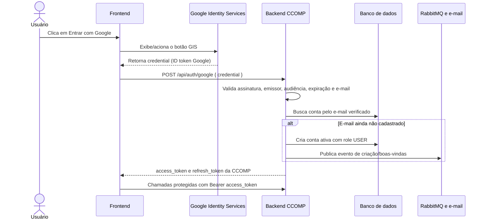

# Login com Google: integração frontend e backend

Este documento descreve o contrato atual do login com Google no backend CCOMP e
o que o frontend precisa fazer para usá-lo. O fluxo usa o botão do **Google
Identity Services (GIS)** no navegador. O GIS entrega um ID token Google ao
frontend; o frontend o envia ao backend, que valida a identidade e emite os
tokens próprios da CCOMP.

Este fluxo autentica o usuário na CCOMP. Ele não concede acesso a APIs do Google
como Drive ou Calendar.

## Visão geral



O fluxo é stateless durante o login: não há callback OAuth no backend nem
sessão HTTP para correlacionar um redirecionamento. O backend valida cada
credencial recebida e devolve tokens da própria aplicação.

## Requisitos

### No Google Cloud

1. Crie ou selecione um projeto no Google Cloud.
2. Configure a tela de consentimento/branding conforme o ambiente e o status de
   publicação do app.
3. Crie uma credencial OAuth do tipo **Web application**.
4. Cadastre as origens JavaScript do frontend em **Authorized JavaScript
   origins**. Uma origem contém esquema, host e, quando aplicável, porta, por
   exemplo `http://localhost:5173` ou `https://app.exemplo.edu.br`.
5. Para este fluxo de callback JavaScript não é necessário cadastrar uma URL de
   callback do backend em **Authorized redirect URIs**.

O GIS precisa do client ID e do escopo de identidade. O escopo usado pelo
backend é `openid`, `profile` e `email`. Não é necessário criar ou enviar um
client secret para o frontend. Consulte a documentação oficial do Google sobre
[configuração do client ID](https://developers.google.com/identity/gsi/web/guides/get-google-api-clientid)
e [exibição do botão](https://developers.google.com/identity/gsi/web/guides/display-button).

### No backend

Configure as variáveis de ambiente:

```dotenv
GOOGLE_OAUTH_ENABLED=true
GOOGLE_CLIENT_ID=seu-client-id.apps.googleusercontent.com
```

`GOOGLE_CLIENT_ID` deve ser o mesmo client ID usado na configuração do GIS no
frontend. O backend não precisa de `CLIENT_SECRET` neste fluxo. Se
`GOOGLE_OAUTH_ENABLED` estiver ausente ou definido como `false`, o endpoint não
é registrado. Se estiver `true` e `GOOGLE_CLIENT_ID` estiver vazio, a aplicação
falha ao iniciar com uma mensagem de configuração.

Em desenvolvimento, coloque os valores no `.env.dev`. Em produção, forneça-os
ao container pelo ambiente/secret manager. O client ID não é segredo; não
coloque credenciais privadas no frontend.

## Botão e chamada ao backend

Carregue a biblioteca GIS na página de login. O botão deve ser renderizado pela
biblioteca do Google. No callback JavaScript, envie o campo `credential` sem
decodificá-lo ou alterar seu conteúdo:

```html
<script src="https://accounts.google.com/gsi/client" async defer></script>
<div id="google-sign-in-button"></div>
```

Exemplo independente de framework, executado depois que a biblioteca GIS
estiver carregada:

```javascript
const GOOGLE_CLIENT_ID = "seu-client-id.apps.googleusercontent.com";
const API_URL = "https://api.exemplo.edu.br";

google.accounts.id.initialize({
  client_id: GOOGLE_CLIENT_ID,
  callback: async ({ credential }) => {
    try {
      const response = await fetch(`${API_URL}/api/auth/google`, {
        method: "POST",
        headers: { "Content-Type": "application/json" },
        body: JSON.stringify({ credential }),
      });

      const body = await response.json();
      if (!response.ok) {
        throw new Error(body.message ?? "Não foi possível entrar com Google.");
      }

      // Guarde os tokens segundo a estratégia de sessão adotada pelo frontend.
      // Em seguida, considere o usuário autenticado e navegue para a página inicial.
      onLoginSuccess(body);
    } catch (error) {
      showLoginError(error.message);
    }
  },
});

google.accounts.id.renderButton(
  document.getElementById("google-sign-in-button"),
  { theme: "outline", size: "large", text: "signin_with" },
);
```

O botão deve ser renderizado depois de `google.accounts.id.initialize`. Em
React/Vue/Angular, carregue o script uma vez e inicialize/renderize o botão
quando o elemento estiver montado. Não crie um botão visual próprio que tente
iniciar o fluxo programaticamente; use o botão GIS renderizado pela biblioteca.

### Requisição

```http
POST /api/auth/google
Content-Type: application/json

{
  "credential": "<ID_TOKEN_DO_GOOGLE>"
}
```

`credential` é um JWT de identidade emitido pelo Google, não um access token da
CCOMP. Envie a credencial inteira somente por HTTPS. Não envie nome, e-mail,
`sub` ou outros claims montados pelo frontend como substitutos do token.

### Resposta de sucesso

O backend responde `200 OK` com o par de tokens da CCOMP:

```json
{
  "access_token": "<JWT_DA_CCOMP>",
  "refresh_token": "<UUID_REFRESH_TOKEN>"
}
```

O access token é usado nas rotas protegidas:

```http
Authorization: Bearer <access_token>
```

O access token expira conforme `jwt.access.expiration` (15 minutos no perfil
prod padrão). O refresh token tem validade de `jwt.refresh.expiration` (7 dias
no perfil padrão), é rotacionado a cada renovação e precisa ser tratado como
uma credencial. Os nomes da resposta são `snake_case` por causa da configuração
global do Jackson.

O frontend pode manter o access token em memória enquanto a aplicação está
aberta. Se optar por persistir tokens no navegador para manter a sessão após
recarregar a página, considere que qualquer JavaScript executado na origem
poderá acessá-los. Nunca coloque tokens na URL nem os escreva em logs.

## Renovação e logout

Quando o access token expirar, envie o refresh token para o endpoint existente
de renovação:

```http
POST /api/auth/refresh
Content-Type: application/json

{
  "refresh_token": "<UUID_REFRESH_TOKEN_ATUAL>"
}
```

Em caso de sucesso, o backend devolve um novo `access_token` e um novo
`refresh_token`. Substitua os dois valores armazenados; o refresh token anterior
é invalidado pela rotação.

No logout, invalide o refresh token atual:

```http
POST /api/auth/logout
Content-Type: application/json

{
  "refresh_token": "<UUID_REFRESH_TOKEN_ATUAL>"
}
```

O logout invalida o refresh token. Um access token já emitido ainda pode ser
aceito até expirar.

## Regras de conta

- O e-mail verificado é a chave da conta da CCOMP. E-mails diferentes resultam
  em contas diferentes.
- Se já houver uma conta com o mesmo e-mail, o login Google usa essa conta, em
  vez de criar uma duplicata. Isso também permite entrar com Google em uma conta
  que foi originalmente cadastrada com senha.
- Se o e-mail ainda não existir, o backend cria uma conta `ACTIVE` com role
  `USER` e publica o evento de criação. O consumidor de notificações envia o
  e-mail de boas-vindas de forma assíncrona; a entrega depende de RabbitMQ e do
  serviço de e-mail estarem operacionais.
- Contas bloqueadas não recebem tokens. Contas desativadas são reativadas pelo
  login, conforme o comportamento já adotado no login local.
- O backend valida que o claim `sub` existe, mas a associação local usa o
  e-mail conforme a regra definida para o produto. Se o usuário mudar o e-mail
  da conta Google, isso pode criar uma conta CCOMP diferente. O Google recomenda
  `sub` como identificador estável; a regra atual prioriza deliberadamente o
  e-mail.

## Validação feita pelo backend

O backend não confia nos dados de perfil enviados isoladamente pelo navegador.
Ele valida a assinatura do ID token usando as chaves públicas do Google e
confere:

- `iss`: `https://accounts.google.com` ou `accounts.google.com`;
- `aud`: corresponde a `GOOGLE_CLIENT_ID`;
- validade temporal (`exp` e demais validadores padrão de timestamp);
- `email` presente e `email_verified=true`;
- `sub` presente.

Se a credencial for inválida, expirada, tiver audiência diferente ou não trouxer
e-mail verificado, nenhum token CCOMP é emitido. A documentação do Google lista
os [critérios de validação do ID token](https://developers.google.com/identity/gsi/web/guides/verify-google-id-token).

## CORS e comunicação entre origens

O CORS do backend está aberto temporariamente para permitir a integração antes
de o domínio do frontend ser definido. O endpoint usa JSON e não usa cookies,
portanto a chamada não requer `credentials: "include"`. A configuração atual
permite os métodos e headers usados pelo `fetch`, inclusive o preflight `OPTIONS`.

Quando o domínio de produção do frontend estiver definido, restrinja as origens
permitidas no backend e cadastre a origem exata também no Google Cloud. O valor
do frontend em `GOOGLE_CLIENT_ID` é público; a validação real da identidade é
feita pelo backend.

## Erros esperados

| Situação | Resposta esperada | O que o frontend deve fazer |
| --- | --- | --- |
| Campo `credential` ausente ou vazio | `400 Bad Request` | Exibir erro de integração e não tentar login local com os claims recebidos. |
| ID token inválido, expirado, audiência incorreta ou e-mail não verificado | `401 Unauthorized` | Pedir que o usuário tente novamente com o botão Google. |
| Conta bloqueada | `401 Unauthorized` | Informar que a conta está indisponível e direcionar para suporte. |
| Erro temporário de rede/backend | `5xx` ou falha de rede | Permitir nova tentativa; não manter a credencial Google em storage. |

Os erros de domínio seguem o formato `ErrorResponse` da API; quando possível,
use `message` ou `messages` para apresentar uma mensagem adequada. Evite mostrar
detalhes internos do backend diretamente ao usuário.

## Checklist de integração

- [ ] `GOOGLE_OAUTH_ENABLED=true` no ambiente do backend.
- [ ] `GOOGLE_CLIENT_ID` configurado no backend e no frontend, com o mesmo valor.
- [ ] Client OAuth do tipo Web application criado no Google Cloud.
- [ ] Origens JavaScript de desenvolvimento e produção cadastradas no Google.
- [ ] Biblioteca GIS carregada e botão renderizado pela API oficial.
- [ ] Frontend envia `credential` para `POST /api/auth/google` por HTTPS.
- [ ] Frontend trata `400`, `401`, `5xx` e falhas de rede.
- [ ] Frontend usa `access_token` como Bearer e implementa refresh/logout conforme
  os endpoints existentes.
- [ ] Em produção, CORS aberto substituído por allowlist do domínio publicado.
- [ ] RabbitMQ e e-mail configurados para o aviso de boas-vindas a novos usuários.

